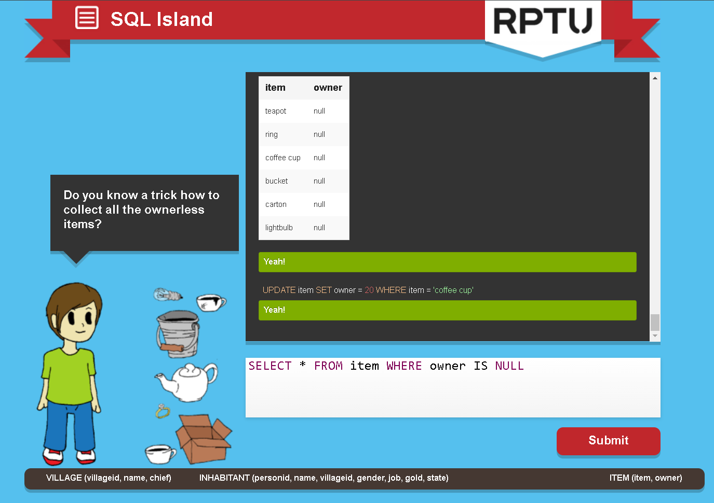

# SQL Island (Task 5)

Game: [SQL Island](https://sql-island.informatik.uni-kl.de/) (played in English).

## 1. What have I learned about databases and SQL so far, just by playing?

- A database is a set of **tables**, and each table stores one kind of thing: the island has `village`, `inhabitant` and `item`.
- The bar at the bottom of the game (e.g. `INHABITANT (personid, name, villageid, gender, job, gold, state)`) is the **schema**: the table name and its columns. It is a map that helps you write queries, not something you type.
- To ask a question you always start with `SELECT`; you can also **change** data with `INSERT` (the game added me as `'Stranger'`) and `UPDATE` (I took the coffee cup by setting its `owner`).
- Every row has an id (`personid`, `villageid`) that identifies it, and other tables point to it (e.g. `item.owner` holds a `personid`).

## 2. Which SQL commands and patterns did I use?

| Command / pattern | Example from the game |
|---|---|
| `SELECT * FROM` | `SELECT * FROM village` |
| `WHERE` with a text value | `SELECT * FROM inhabitant WHERE job = 'butcher'` |
| `AND` to combine conditions | `... WHERE job = 'weaponsmith' AND state = 'friendly'` |
| Selecting specific columns | `SELECT personid FROM inhabitant WHERE name = 'Stranger'` |
| `WHERE` with a number | `SELECT gold FROM inhabitant WHERE personid = 20` |
| `IS NULL` | `SELECT * FROM item WHERE owner IS NULL` |
| `INSERT` | `INSERT INTO inhabitant (...) VALUES ('Stranger', ...)` |
| `UPDATE` | `UPDATE item SET owner = 20 WHERE item = 'coffee cup'` |

## 3. In my own words

- **Table:** a list of things of the same kind, like a sheet in Excel (all inhabitants).
- **Row:** one single thing in that list (one inhabitant, e.g. Ernest Perry).
- **Column:** one property that every row has (name, job, gold…).
- **Query:** a question (or command) written in SQL that the database answers with a table of results.

## 4. What surprised me? What is still confusing?

- **Surprised:** how readable SQL is: `SELECT gold FROM inhabitant WHERE personid = 20` is almost an English sentence.
- **Mistakes I made (and fixed):**
  - Typing only the table name (`INHABITANT (name)`): every query must start with a command like `SELECT`.
  - Writing `"friendly"` without `WHERE state =`, so SQL ignored it and returned every row.
  - Forgetting quotes around text (`job = weaponsmith`): without quotes SQL thinks it is a column name. Text needs `'...'`, numbers don't.
  - On my keyboard the accent key gives `¨` instead of the straight quote `'`.
- **Still confusing:** why `NULL` needs `IS NULL` instead of `= NULL`.

I will finish the rest of the game at home.
