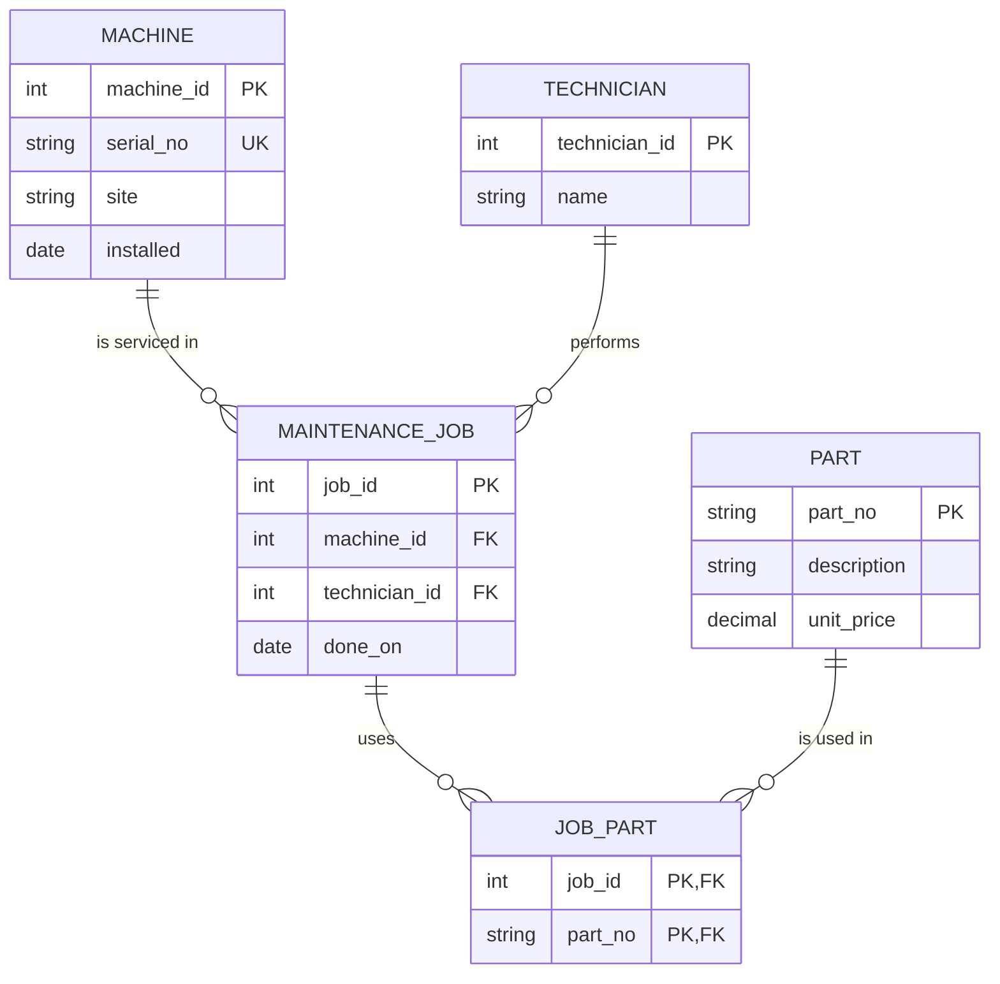

# ER audit of the legacy maintenance schema

Back to [Module 2](README.md) · Schema: [legacy-setup.sql](legacy-setup.sql) · Count queries: [cardinality.sql](cardinality.sql) ([output](cardinality-results.txt))

## 1. Entities, attributes and intended primary keys

| Entity | Attributes | Intended primary key | In the legacy schema |
|---|---|---|---|
| **Machine** | serial_no, site, installed | `machine_id` (surrogate), with `serial_no` kept `UNIQUE` (natural key) | table `machine`, no key at all, identified by `machine_name` text |
| **Part** | description, unit_price | `part_no` (natural key: short, stable, already unique in the real world) | table `part`, `part_no` not declared unique (P-1003 is duplicated) |
| **MaintenanceJob** | done_on | `job_id` | table `maint_job`, `job_id` not declared as key |
| **Technician** | name | `technician_id` (surrogate) | **no table**: only a free-text name inside `maint_job` |
| **JobPart** (junction) | qty (optional) | (`job_id`, `part_no`) | **no table**: hidden as a comma-separated list in `maint_job.parts_used` |

**Entity or attribute?** The maintenance job is an **entity**, not just a relationship: it has its own identity (`job_id`) and its own data (`done_on`), and it is referenced by other things (the parts used). The technician is an **entity** too: a technician performs many jobs (Beier: 2), and storing only a name means a typo or a second "Beier" creates a different person.

## 2. Reconstructed ER diagram (what the designer meant)

Crow's-foot reading: `||` = exactly one, `o{` = zero or many. Example: one machine is serviced in zero or many jobs; each job belongs to exactly one machine.

## 3. Cardinalities, proved with counts

| Relationship | Count that proves it | Cardinality |
|---|---|---|
| Machine – MaintenanceJob | 4 jobs but only 3 distinct machines; `cnc-01` has 2 jobs | **1 : n** |
| Technician – MaintenanceJob | Beier has 2 jobs, each job has one technician | **1 : n** |
| MaintenanceJob – Part | job 1 uses 2 parts (`P-1001,P-1002`) **and** P-1001 appears in 2 jobs (1 and 3) | **m : n** |
| Machine – serial number (nameplate) | 4 machines, 4 distinct serials | **1 : 1** |

## 4. What the legacy schema models and what it hides

- **1:1 (machine ↔ serial number):** modeled only by accident, as a plain column; nothing stops two machines from sharing a serial number, because `serial_no` is not `UNIQUE`.
- **1:n (machine → jobs, technician → jobs):** hidden; `maint_job` stores a machine *name* and a technician *name* as text instead of foreign keys, so a job can point to a machine that does not exist (`cnc-05`).
- **m:n (jobs ↔ parts):** hidden and broken; it lives in a comma-separated text column (`parts_used`), which violates 1NF and cannot be joined (job 1 disappears from a naive join). It needs the junction table `JOB_PART`.
