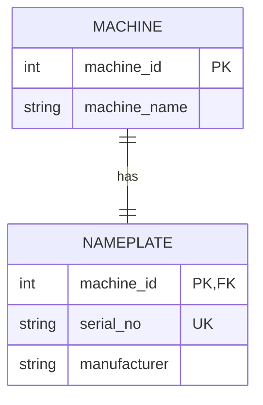
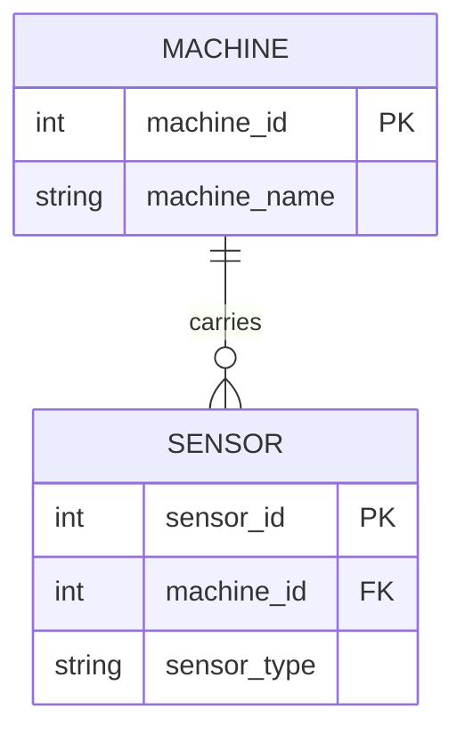
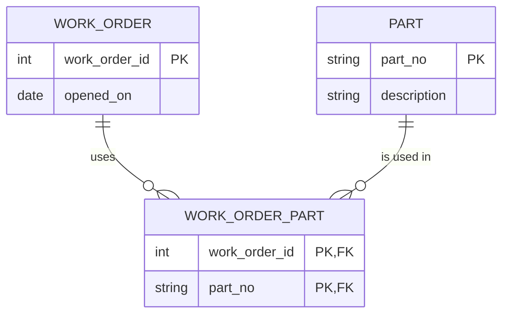
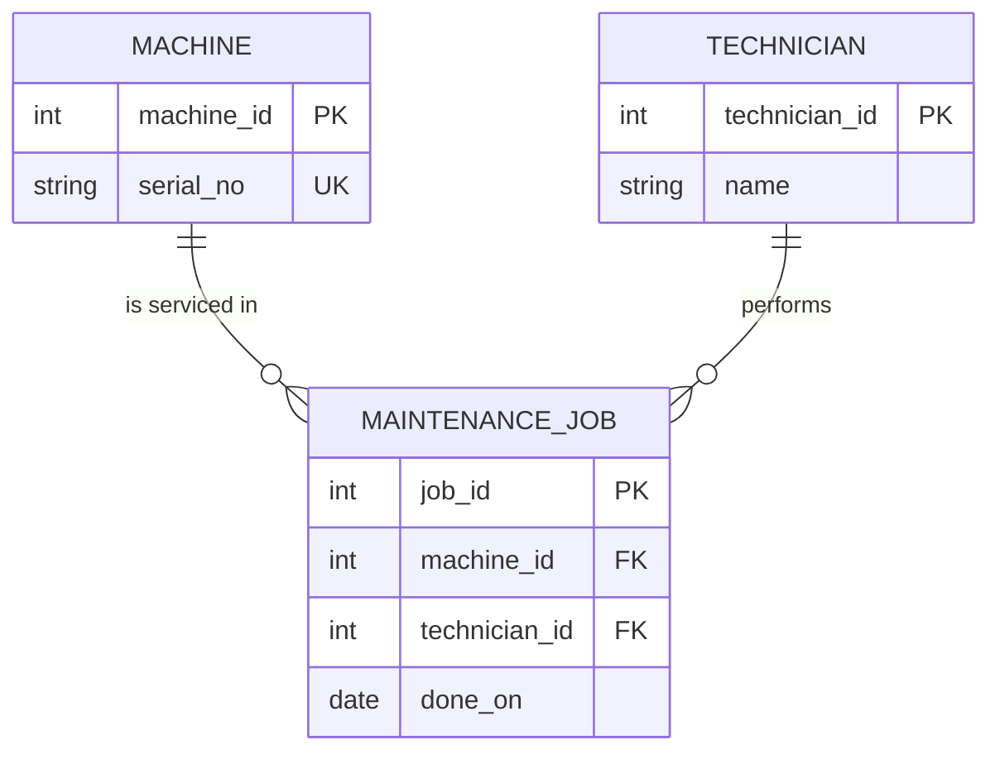

# Module 2, Task B: From words to sketch

Back to [Module 2](README.md) · [Study log](study-log.md)

Before drawing, I answered each scenario myself. My first answers are kept next to the correct ones, because the two I got wrong are exactly the defects of the legacy schema.

| # | Question | My first answer | Correct | Why |
|---|---|---|---|---|
| 1 | Machine and nameplate: which cardinality? | 1:1 | 1:1 ✅ | each machine has one nameplate, each nameplate belongs to one machine |
| 2 | Machine and sensors: where does the foreign key go? | on the sensor | on the sensor ✅ | the FK always goes on the "many" side: each sensor points to its machine |
| 3 | Work orders and parts: a list column or a junction table? | a list column ❌ | junction table | a list in one cell is the `P-1001,P-1002` defect: it cannot be joined (job 1 disappeared) |
| 4 | Technician: attribute or entity? | attribute (just a name) ❌ | entity | a technician performs many jobs and has their own data; as free text, a typo ("Beir") creates a "new" person |

**Rule I took from this:** if something repeats across many rows and has its own data, it is a **table** (entity); if it only describes something else (a date, a colour), it is a **column** (attribute).

Crow's-foot reading: `||` = exactly one, `o{` = zero or many, `|{` = one or many.

## 1. Machine and nameplate: 1:1

The key: `NAMEPLATE.machine_id` is **both** primary key and foreign key, so a machine can have at most one nameplate. Is the nameplate a separate entity or an attribute? If it has no life of its own, `serial_no` and `manufacturer` can simply be columns of `MACHINE` (that is what the legacy schema did with `serial_no`); a separate table only pays off if nameplates are tracked independently (for example, replaced).

## 2. Machine and sensors: 1:n

The foreign key goes on the **many** side (`SENSOR.machine_id`), like each child pointing to their mother, instead of the mother keeping a list of children in one cell.

## 3. Work orders and parts: m:n

The extra table is the **junction table** `WORK_ORDER_PART`: one row per (order, part) combination. Its key is the **pair** `(work_order_id, part_no)`, which is what enforces "an order can list a given part only once".

## 4. Maintenance job, machine and technician: entity vs. attribute

The **job** is an entity, not just a relationship: it has its own identity (`job_id`) and its own data (`done_on`), and parts are attached to it. The **technician** is an entity too (one technician, many jobs). The **date** is an attribute of the job.

## Proof: CREATE TABLE + COUNT (sketch 3)

[er-proof.sql](er-proof.sql) ([output](er-proof-results.txt)) builds sketch 3 in memory, inserts two orders and two parts, and counts both sides:

| work_order_id | parts |
|---|---|
| 1 | 2 |
| 2 | 1 |

| part_no | orders |
|---|---|
| P-1001 | 2 |
| P-1002 | 1 |

Order 1 uses **2** parts **and** P-1001 is used by **2** orders: both sides go above 1, so the relationship is **m:n**. Inserting P-1001 a second time on order 1 is rejected (`UNIQUE constraint failed`), which proves the composite key enforces "once per order".
