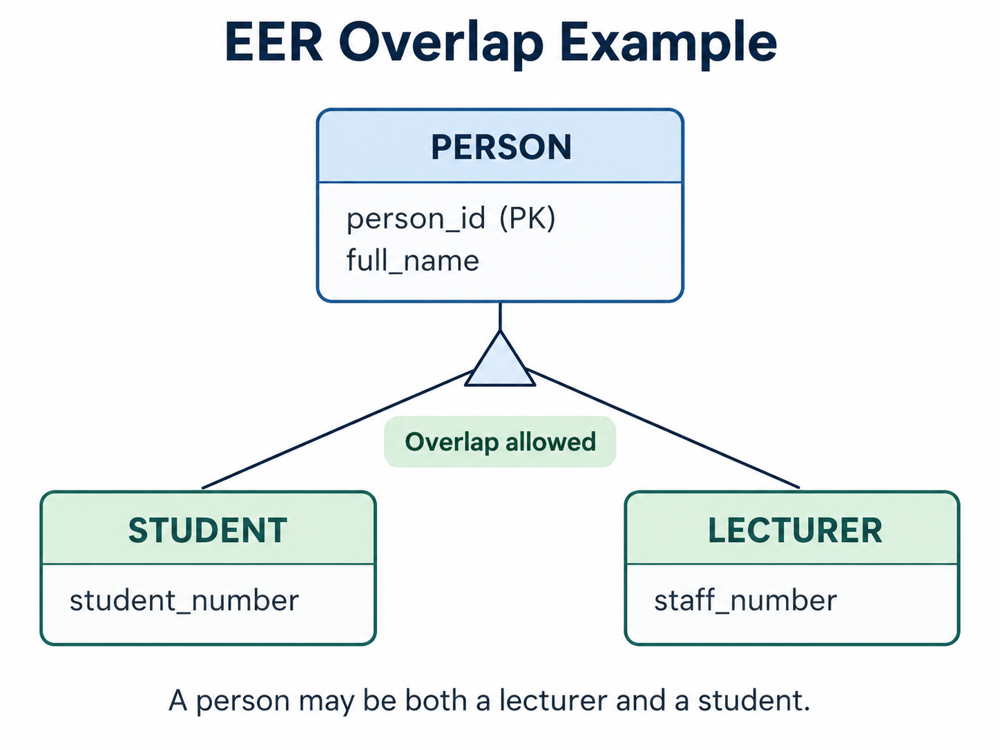

# Module 2: Study log

Back to [Module 2](README.md)

## Task A: Study in my pod

_To be completed: references used, things I googled, remarkable findings, LLM Q&A with verification, and my two best ER sketches._

## Task B: From words to sketch

_To be completed: the four sketches (1:1, 1:n, m:n, entity vs. attribute) and one `CREATE TABLE` + `COUNT` proof._

## Task C: Explain & share with another pod

**When and who:** 17 October 2026, the day I joined my Task Pod ([Leviscus Njeru](https://github.com/leviscusgnjeru/databases), Ian Okach, Chanbopha Rin). I took part in the pod discussion and in the exchange with the neighbouring pod. Honestly, I did not fully understand the example during the discussion; I understood it afterwards by reviewing it on my own.

**The shared image:** the pod pair chose an EER example about a university. The image below was made and posted by **Leviscus Njeru** in our Discord channel (`#in-class-tasks`, 17 October 2026, 19:37); it is reused here with credit, as the image our pods agreed on. His documentation of the discussion is in [his study log](https://github.com/leviscusgnjeru/databases/blob/main/Module02/study-log.md).

### What the example shows (in my own words)

- **PERSON** is the general entity (the *supertype*). It holds what every person has: `person_id` and `full_name`.
- **STUDENT** and **LECTURER** are *subtypes*: special kinds of person with their own extra data (`student_number`, `staff_number`). They inherit `person_id` and `full_name` from PERSON, so those are not repeated.
- **"Overlap allowed"** means one person can be **both** at the same time, for example a lecturer who is also enrolled in a master's programme. The opposite would be **disjoint**: a person could be only one of the two.
- In tables, this means `STUDENT` and `LECTURER` each have a `person_id` that points to `PERSON`, and the **same `person_id` may appear in both**. The person is stored once, not twice.

### What I checked on my own afterwards

- **The diagram does not say whether every person must be a student or a lecturer** (total vs. partial specialization). Could the university store a person who is neither, for example an administrator? That is a separate business rule the picture does not answer.
- **Notation:** the triangle is a UML-style generalization symbol. In classic EER notation, overlap is drawn as a circle with an **"o"** and disjointness with a **"d"**. Same meaning, different notation.
- **Mermaid's `erDiagram` cannot draw inheritance** (the workbook says so), which is why the example is a separate image or a `classDiagram`.

### Agreed learning (pod discussion)

1. Shared data goes in the supertype (PERSON) and role-specific data in the subtypes (STUDENT, LECTURER).
2. Student and Lecturer **overlap**: one person can hold both roles, so the subtypes are not mutually exclusive.
3. In a relational design, both subtype tables reference the same `PERSON.person_id`, which avoids storing the same person twice.

**Left open:** whether every person must belong to at least one subtype (total) or not (partial); the example does not state it.
