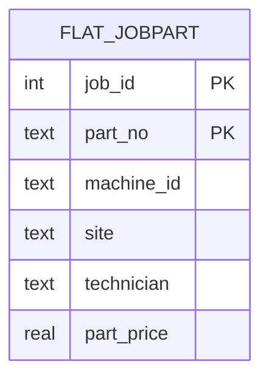
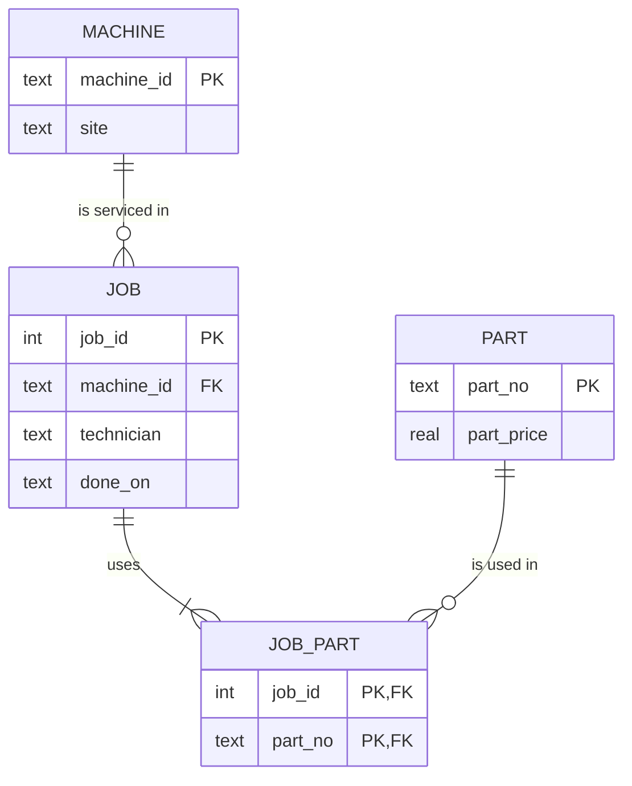

# Module 5: Normalization notes

Back to [Module 5](README.md)

## Round 1: See it (dependencies and two pictures)

The five-row extract:

| job_id | machine_id | site | technician | part_no | part_price |
|---|---|---|---|---|---|
| 1 | cnc-01 | Gütersloh | tech-0 | P-0001 | 6.00 |
| 1 | cnc-01 | Gütersloh | tech-0 | P-0002 | 7.00 |
| 2 | cnc-02 | Gütersloh | tech-1 | P-0001 | 6.00 |
| 2 | cnc-02 | Gütersloh | tech-1 | P-0003 | 8.50 |
| 3 | cnc-01 | Gütersloh | tech-0 | P-0003 | 8.50 |

### My functional dependencies

| FD | Guaranteed by the domain or only observed? | My reasoning |
|---|---|---|
| `machine_id → site` | **domain** | A machine stands in one place at a time. It *can* be moved to another city, but then the fact changes for the machine as a whole; that is an update, not a second site. My first thought was "the same machine could be used in different cities", which is exactly why the site must be stored once: if it is copied on every job row, a move leaves some rows in the old city (the update anomaly in Round 2). |
| `part_no → part_price` | **domain** | A part number has one current price. (If prices changed over time and old jobs had to keep the old price, the price would belong to the job-part row instead; this studio assumes one price.) |
| `job_id → machine_id`, `job_id → technician` | **domain** | One maintenance job is done on one machine by one technician. |
| `machine_id → technician` | **only observed** | In the five rows `cnc-01` always appears with `tech-0`, but nothing in the domain says a machine always gets the same technician. My first answer was "yes", with the same doubt as for the site. The 200k table proves it is an accident: `cnc-02` was serviced by all 7 technicians. |

**Candidate key:** `(job_id, part_no)`. Neither attribute alone determines the row: a job has several parts, and a part is used by several jobs.

### Checking the FDs on the 200k table

[round1-fd-check.sql](round1-fd-check.sql) counts, for each candidate FD `X → Y`, how many `X` values have more than one `Y` ([output](round1-results.txt)):

| FD | `X` values that break it |
|---|---|
| `machine_id → site` | 0 |
| `part_no → part_price` | 0 |
| `job_id → technician` | 0 |
| `job_id → machine_id` | 0 |
| `machine_id → technician` | **50** (every machine has 7 different technicians) |

Zero violations only means the FD holds **in this data**; whether it *must* hold is a domain decision. One violation is enough to prove an FD does not hold.

### Two ER sketches

**The table as it is:** one entity, every fact on every row.



Hidden inside it: `job_id → machine_id → site` (transitive) and `part_no → part_price` (partial: depends on only half of the key).

**The schema it should be (3NF):**



**Gate question, "which arrow disappears in the second one?":** the arrows from the half-key `part_no → part_price` and from the non-key `machine_id → site` no longer exist inside a job-part row. In the second diagram every attribute depends only on the key of its own table.

### Diff against the LLM

**Prompt** (from the workbook): *"Here is a flat table: `<columns and the five rows>`. List the functional dependencies you can infer, and mark which are domain facts and which are only observed in these rows."*

**LLM used:** Claude. Its list: `job_id → machine_id, technician`, `machine_id → site`, `part_no → part_price` as domain facts; `machine_id → technician`, `part_price → part_no` and `technician → machine_id` as true in the five rows only; `site → anything` does not hold.

| Point | Me | LLM | Who is right |
|---|---|---|---|
| `machine_id → site` | yes, with a doubt about moving machines | domain fact | both; moving a machine is an update of the one fact |
| `machine_id → technician` | yes at first | only observed | **the LLM**; the 200k data shows 7 technicians per machine |
| `part_price → part_no` | not considered | only observed (6.00 only appears with P-0001) | the LLM; two parts can have the same price, so it is an accident |

## Round 2: Break it (the three anomalies)

Script: [round2-anomalies.sql](round2-anomalies.sql) · Output: [round2-results.txt](round2-results.txt)

| Anomaly | Statement | What happened |
|---|---|---|
| **Update** | `UPDATE flat5 SET site = 'Bielefeld' WHERE machine_id = 'cnc-01';` | **3 rows** touched to change **one** fact. When a second session then "fixes" only job 3 back to Gütersloh, `cnc-01` is in **two cities at once** (`SELECT DISTINCT` returns both). |
| **Insert** | `INSERT INTO flat5(part_no, part_price) VALUES ('P-0004', 9.75);` | A new part cannot be recorded without a job: the only way is a row with `job_id`, `machine_id`, `site` and `technician` all `NULL`. |
| **Delete** | `DELETE FROM flat5 WHERE job_id = 1 AND part_no = 'P-0002';` | P-0002 was used only by job 1. Deleting that row also deleted **the price of P-0002** (7.00): 0 rows still know it. |

## Round 3: Build it (200k rows and 3NF)

[setup.sql](setup.sql) builds `flat_jobpart`; [normalize.sql](normalize.sql) decomposes it with `PRAGMA foreign_keys = ON` ([output](normalize-results.txt)).

| Table | Rows |
|---|---|
| `flat_jobpart` | 200,000 |
| `machine` | 50 |
| `part` | 10 |
| `job` | 20,000 |
| `job_part` | **200,000** (matches the flat table) |

- **With foreign keys ON, the decomposition still loads** and `PRAGMA foreign_key_check` reports no orphans, because the parent tables (`machine`, `part`) are filled before the child tables (`job`, `job_part`).
- **The `DISTINCT` assumption held:** inserting into `job` with `job_id` as primary key did not fail, so every job really has exactly one machine, technician and date.
- **Gate question, "why does `part` have 10 rows, not 40?":** the generator multiplies 20,000 jobs by `k = 1..10` only, and the part number is `(k % 40) + 1`, so it only reaches `P-0002` to `P-0011`. The `% 40` suggests 40 parts, but with only 10 values of `k` it never wraps around.

| Form | Rule | What it removed here |
|---|---|---|
| **1NF** | Atomic values, no lists | (already atomic: one part per row, unlike Module 2's `parts_used`) |
| **2NF** | No partial dependency on part of the key | `part_no → part_price` moved to `part`; `job_id → machine_id, technician, done_on` moved to `job` |
| **3NF** | No transitive dependency | `machine_id → site` moved to `machine` |

## Round 4: Race it (normalized vs. denormalized)

[report.sql](report.sql) builds `report_jobpart` (site, technician and price copied onto all 200,000 rows) with the index `ix_report_machine`. [race.sql](race.sql) shows both plans, checks that both queries give the same answer, warms the cache with one untimed run each, then alternates A and B five times ([output](race-results.txt)).

**My prediction:** B (one table) wins, but only by a little. **Result: wrong, A won.**

**Same answer:** both return 350 groups with a total cost of 722,610.0 (the number the workbook gives).

**Plans:**

```text
A (normalized)                                         B (denormalized)
|--SCAN jp                                             |--SCAN report_jobpart USING INDEX ix_report_machine
|--SEARCH j USING INTEGER PRIMARY KEY (rowid=?)        `--USE TEMP B-TREE FOR GROUP BY
|--SEARCH m USING INDEX sqlite_autoindex_machine_1 (machine_id=?)
|--SEARCH p USING INDEX sqlite_autoindex_part_1 (part_no=?)
`--USE TEMP B-TREE FOR GROUP BY
```

**Timings** (SQLite 3.54.0 CLI, `.timer on`, warm cache, seconds converted to ms):

| Run | A: four-way join | B: one table |
|---|---|---|
| 1 | 102.2 | 126.4 |
| 2 | 92.0 | 124.0 |
| 3 | 91.4 | 103.6 |
| 4 | 81.5 | 103.1 |
| 5 | 92.8 | 121.2 |
| **median** | **92.0 ms** | **121.2 ms** |

A second full run gave the same picture (A 79 to 97 ms, B 100 to 134 ms), so the result is not noise.

**Why the one-table design lost here:**
- **The plan for B uses the index in the worst way.** `SCAN report_jobpart USING INDEX ix_report_machine` walks the whole index in `machine_id` order (to help the `GROUP BY`) and then jumps to the table for **every one** of the 200,000 rows to read `site`, `technician`, `part_price` and `done_on`. That is 200,000 extra lookups. Round 5 tests dropping the index.
- **The joins are cheap here.** `machine` has 50 rows and `part` 10, so every `SEARCH` hits pages that are already in memory. A only has to scan `job_part`, which is narrow (two columns).
- **Row width.** Every `report_jobpart` row carries site, technician, price and date, so B has more bytes to read than A's scan of `job_part`.

Denormalization only pays when the **join** is the expensive part. On this dataset it is not.

## Round 5: Price it (writes and storage)

Script: [price.sql](price.sql) · Output: [price-results.txt](price-results.txt)

### One site change

**My prediction:** 4,000 rows in the report table (200,000 rows / 50 machines). **Correct.**

| | Rows touched | Time |
|---|---|---|
| `UPDATE machine SET site = 'Bielefeld' WHERE machine_id = 'cnc-02'` | **1** | 6.5 ms |
| `UPDATE report_jobpart SET site = 'Bielefeld' WHERE machine_id = 'cnc-02'` | **4,000** | 57.6 ms |

1 versus 4,000 is the number that scales: it is the update anomaly from Round 2, now with a price tag. And if anyone updates `machine` but forgets `report_jobpart`, the dashboard shows the old site.

### Storage (`dbstat`)

| Object | Bytes | KB |
|---|---|---|
| `job` + `job_part` + `part` + `machine` (tables only, the workbook query) | 4,071,424 | 3,976 |
| + their primary-key indexes (`sqlite_autoindex_job_part_1` alone is 4,087,808) | 8,167,424 | 7,976 |
| `report_jobpart` (table only) | 11,091,968 | 10,832 |
| + `ix_report_machine` | 14,082,048 | 13,752 |

The denormalized table alone is **2.7× bigger** than the four normalized tables, because site, technician, price and date are repeated on every row. Counting the indexes it is still 1.7× bigger. Note that the workbook's storage query leaves out the indexes; `job_part`'s primary-key index is as big as the table itself.

### The index experiment

`DROP INDEX ix_report_machine;` changed B's plan from `SCAN report_jobpart USING INDEX ix_report_machine` to a plain `SCAN report_jobpart`:

| B (report table) | Runs | Median |
|---|---|---|
| with `ix_report_machine` | 117.6, 114.1, 112.6 ms | 114.1 ms |
| **without** the index | 86.0, 70.5, 71.3 ms | **71.3 ms** |

Then I ran the full race again without the index ([output](race-noindex-results.txt)), alternating A and B five times:

| | Median |
|---|---|
| A: four-way join | 85.3 ms |
| B: one table, no index | **69.1 ms** |

**Now B wins, by about 19%**: a small win, which was my original prediction. The index was the reason B lost in Round 4. Reading the table once from start to end is cheaper than walking the index and fetching every row from the table. That is a second negative result: the index made the query slower, exactly like in Module 3.

### Filled-in benchmark table

| Design | Dashboard query (ms, warm, median) | Rows changed by one site update | Storage (KB, tables only) | Redundancy? |
|---|---|---|---|---|
| Normalized (3NF) | 92.0 (Round 4) / 85.3 (Round 5 rerun) | **1** | 3,976 | none |
| Denormalized (report) | 121.2 with index / **69.1 without index** | **4,000** | 10,832 | site/technician/price repeated |
